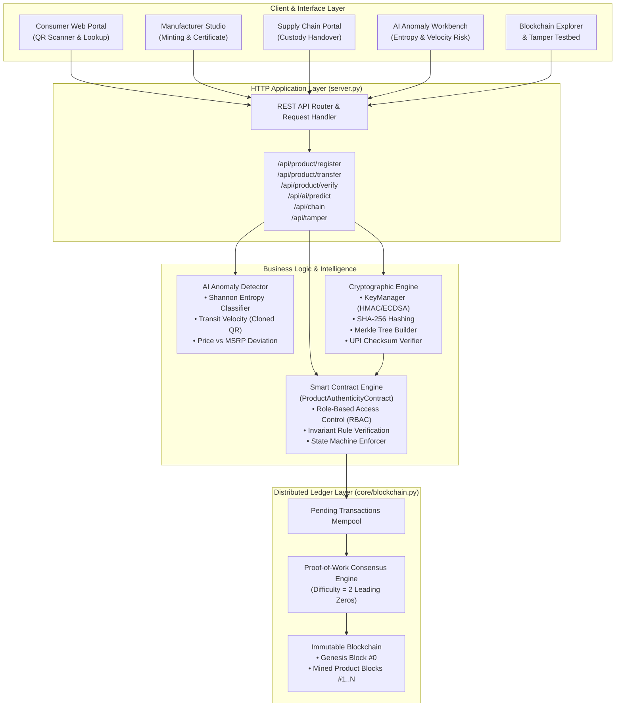
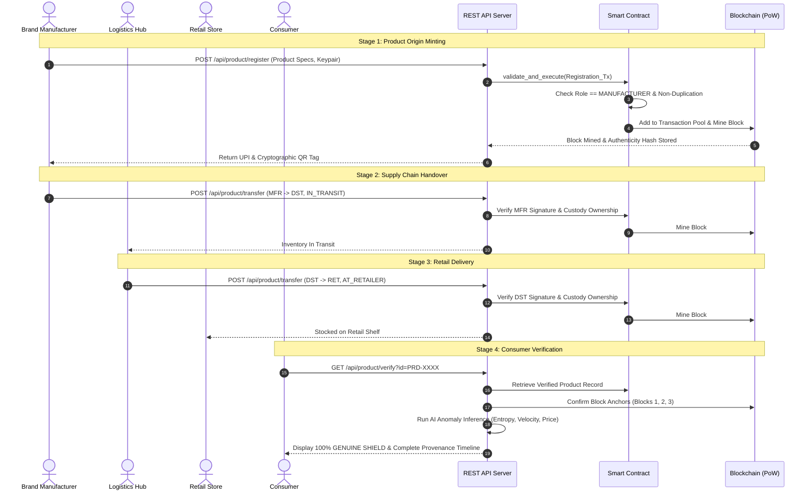
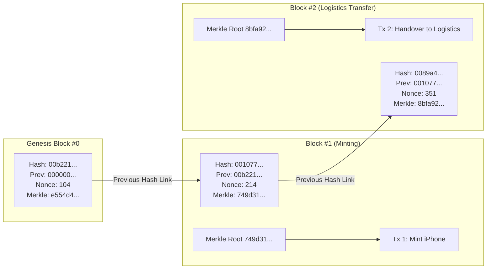
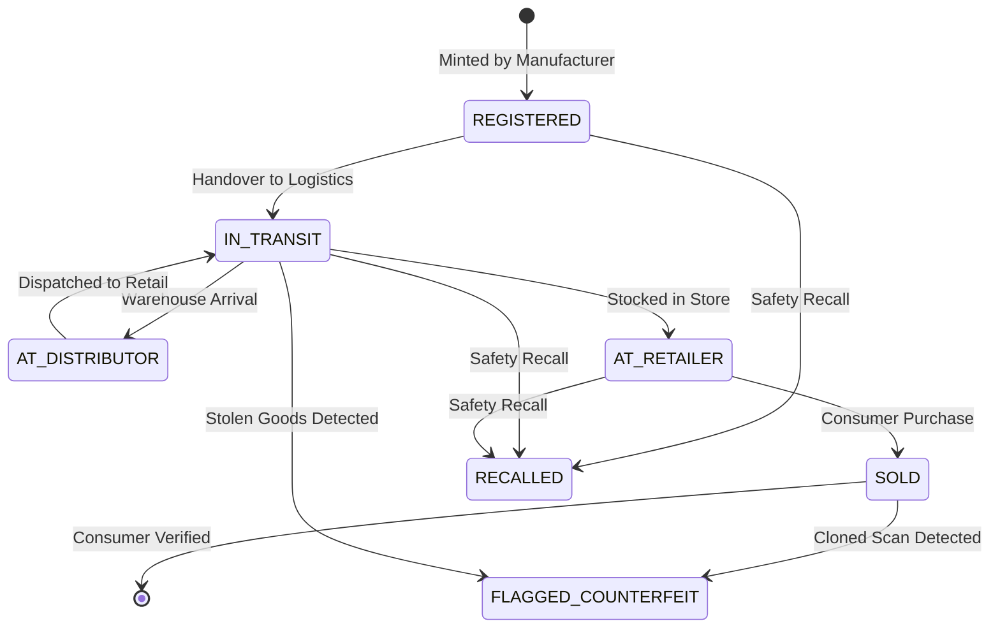

# Architecture & Technical Specifications: AuthentiChain

## 1. System Architecture Diagram



---

## 2. Transaction Flow & Handover Sequence Diagram



---

## 3. Blockchain Block Linking & Merkle Tree Architecture



---

## 4. Smart Contract State Machine



---

## 5. API Schema Specification

### 5.1 POST `/api/product/register`
**Request Payload:**
```json
{
  "entity_id": "MFR-001",
  "product_name": "iPhone 16 Pro Max 256GB",
  "brand": "Apple",
  "category": "Electronics",
  "batch_number": "BATCH-AAPL-2026A",
  "manufacture_date": "2026-11-18",
  "specs": {
    "color": "Titanium",
    "msrp_usd": 1199.00
  }
}
```

**Success Response (200 OK):**
```json
{
  "status": "SUCCESS",
  "product_id": "PRD-APPL-ELE-6CC5D5-52E3FD-373A",
  "transaction": {
    "status": "ACCEPTED",
    "tx_id": "TX-56CE4D14BEEBBEAF"
  },
  "mining": {
    "block_index": 1,
    "block_hash": "001077ad49d12702160dc06e27200812a717eace85a00f3a0127792e0af5a60e"
  }
}
```

### 5.2 GET `/api/product/verify?id=<product_id>`
**Success Response (200 OK):**
```json
{
  "is_genuine": true,
  "product_id": "PRD-APPL-ELE-6CC5D5-52E3FD-373A",
  "verdict": "100% GENUINE PRODUCT VERIFIED ON BLOCKCHAIN",
  "product_details": {
    "product_name": "iPhone 16 Pro Max 256GB",
    "brand": "Apple",
    "batch_number": "BATCH-AAPL-2026A",
    "current_owner": "BestBuy Retail Store #442",
    "current_status": "AT_RETAILER",
    "current_location": "BestBuy Retail Store #442, San Francisco, CA"
  },
  "history": [
    { "type": "PRODUCT_REGISTRATION", "timestamp": 1731908000 },
    { "type": "CUSTODY_TRANSFER", "timestamp": 1731908500 }
  ],
  "ai_prediction": {
    "authenticity_percentage": 100.0,
    "classification": "GENUINE",
    "risk_tier": "LOW_RISK",
    "entropy": 3.619
  }
}
```
