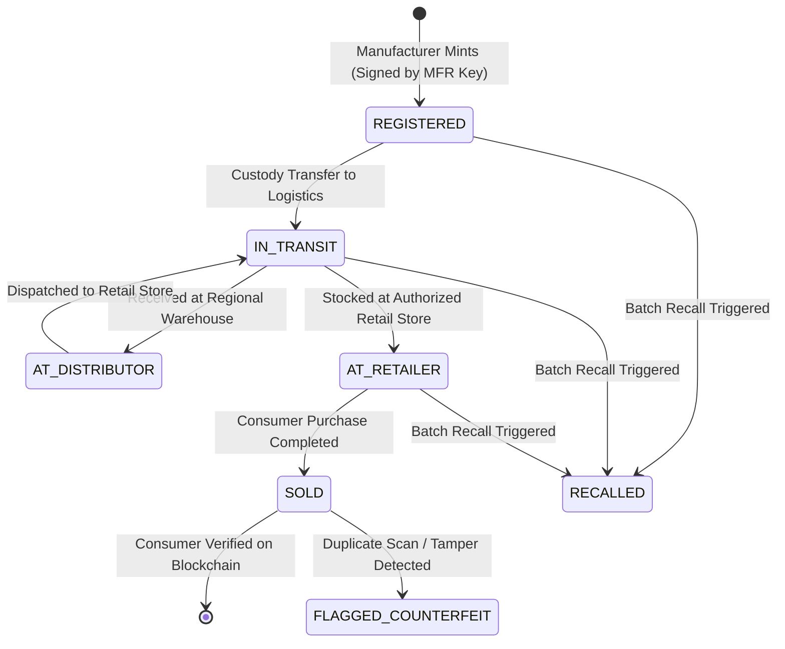

# Comprehensive Academic Project Report: E-Commerce Product Authenticity Blockchain

**Project Title:** E-Commerce Product Authenticity & Verification Protocol (AuthentiChain)  
**Academic Domain:** Distributed Ledger Technologies (Blockchain) & Applied Artificial Intelligence  
**Implementation Technology:** Python 3.13, Standard Cryptography (SHA-256, HMAC-SHA256, Merkle Trees), Web REST API, Responsive HTML5/CSS3/JavaScript  

---

## Executive Summary

Counterfeiting in global e-commerce represents an economic loss exceeding \$500 billion annually, threatening consumer safety, brand reputation, and market trust. Traditional anti-counterfeiting solutions rely on centralized databases, serial barcode labels, or physical holographic stickers. However, centralized databases are susceptible to single points of failure, insider tampering, and database breaches, while physical barcodes can be copied and applied to fake items.

This project implements **AuthentiChain**, a product-registration, supply-chain tracking, and consumer verification system built upon an educational blockchain framework with embedded smart contracts and an AI-powered counterfeit anomaly detection engine. Every product receives a cryptographically verifiable **Unique Product Identifier (UPI)** and is anchored to an immutable blockchain ledger through Proof-of-Work (PoW) consensus. Custody transfers are authorized via digital signatures, and smart contracts enforce strict role-based access control (RBAC). A multi-factor AI engine analyzes serial entropy, transit velocity (detecting cloned QR codes), and pricing anomalies to offer defense-in-depth against counterfeiters.

---

## 1. Problem Definition

### 1.1 The Counterfeiting Crisis in E-Commerce
The exponential growth of decentralized marketplace platforms (e.g., third-party merchant listings) has made it trivial for counterfeiters to infiltrate global supply chains. Key affected sectors include:
- **Luxury Goods & Apparel:** High-margin designer handbags, watches, and sneakers where counterfeiters replicate aesthetic designs.
- **Pharmaceuticals & Healthcare:** Fake antiviral drugs, vaccines, and supplements containing inert or toxic compounds, posing direct hazards to human life.
- **Consumer Electronics:** Counterfeit batteries, chargers, and smartphones lacking regulatory compliance, causing fire and electrical hazards.

### 1.2 Vulnerabilities of Traditional Solutions
Traditional anti-counterfeit architectures suffer from three critical structural flaws:
1. **Centralized Trust Vulnerability:** When product authentication depends on a central database hosted by a retailer or logistics provider, any database administrator or compromised API key can silently alter records, reassign serial numbers, or create ghost entries.
2. **Barcode / QR Duplication (The "Clone" Attack):** Static barcodes or standard QR codes are easily photocopied. Once an attacker acquires one genuine product packaging, they can print 10,000 duplicate barcodes and attach them to fake items. Without timestamped, immutable custody handovers, consumers cannot identify whether they hold the original or a cloned duplicate.
3. **Information Silos in Multi-Tier Logistics:** Manufacturers, freight forwarders, customs depots, and retail outlets operate disparate software systems. There is no unified, tamper-evident audit trail connecting raw manufacturing to the retail shelf.

### 1.3 Why Blockchain is Suitable
Blockchain provides specific cryptographic and distributed systems properties that directly solve these challenges:
- **Decentralized Immutability:** Once a product block is mined and linked via SHA-256 hashes, historical transactions cannot be modified or deleted without invalidating all subsequent blocks across the network.
- **Asymmetric Cryptographic Non-Repudiation:** Only the legitimate brand owner holding the verified private key can mint and digitally sign product registrations. Unauthorized third parties cannot forge genuine genesis records.
- **Strict State Machine (Smart Contracts):** Smart contract logic programmatically rejects invalid state transitions (e.g., selling an item that was never logged as received by an authorized retailer) and blocks duplicate product ID minting.
- **Transparent Consumer Verification:** End consumers can independently audit the entire custody trail from origin factory to store shelf without needing privileged database credentials.

---

## 2. System Design

### 2.1 Stakeholders & Roles
The system defines four primary supply-chain entities governed by Role-Based Access Control (RBAC):

1. **Brand Manufacturer (`MANUFACTURER`):**
   - Owns private cryptographic keys and verified identity.
   - Generates Unique Product Identifiers (UPI) with embedded checksums.
   - Mints Genesis product transactions on-chain.
   - Generates digitally signed Certificates of Authenticity and QR code tags.
2. **Logistics & Freight Forwarders (`DISTRIBUTOR`):**
   - Receives batches from manufacturers.
   - Cryptographically signs custody transfer handovers.
   - Logs GPS locations and transit checkpoints.
3. **Retail Stores / Fulfillment Hubs (`RETAILER`):**
   - Receives inventory from distributors and verifies authenticity on-chain before shelving.
   - Updates status to `AT_RETAILER` or `SOLD`.
4. **End Consumer (`CONSUMER`):**
   - Uses the web portal or smartphone camera to scan product QR tags.
   - Performs real-time blockchain provenance lookups and reviews AI anomaly risk assessments.
5. **Auditor / Regulatory Inspector (`AUDITOR`):**
   - Audits ledger integrity, reviews tamper logs, and issues official recall or blacklist alerts for compromised batches.

### 2.2 System Architecture Components
The system follows a modular 5-tier architecture:

```
┌─────────────────────────────────────────────────────────────────┐
│               1. Presentation Layer (Web UI)                   │
│   • Consumer Verification Portal    • Manufacturer Minting      │
│   • Supply Chain Custody Portal     • AI Anomaly Workbench      │
│   • Blockchain Explorer & Interactive Tamper Testbed            │
└────────────────────────────────┬────────────────────────────────┘
                                 │ HTTP / JSON REST APIs
┌────────────────────────────────▼────────────────────────────────┐
│             2. Application & REST API Server Layer              │
│   • Endpoint Routing               • Request Validation         │
│   • Static File Engine             • Error & Exception Handling │
└────────────────────────────────┬────────────────────────────────┘
                                 │
     ┌───────────────────────────┴───────────────────────────┐
     ▼                                                       ▼
┌───────────────────────────────┐       ┌────────────────────────────────┐
│   3. Smart Contract Engine    │       │ 4. AI Anomaly Engine           │
│   • Role-Based Access Control │       │   • Shannon Entropy Classifier │
│   • Invariant Rule Validation │       │   • Transit Velocity Anomaly   │
│   • Product State Machine     │       │   • Price vs MSRP Deviation    │
└──────────────┬────────────────┘       └────────────────┬───────────────┘
               │                                         │
┌──────────────▼─────────────────────────────────────────▼────────┐
│               5. Core Blockchain & Cryptographic Engine         │
│   • SHA-256 Block & Transaction Hashing                         │
│   • Merkle Tree Construction & Root Verification                │
│   • Proof-of-Work (PoW) Consensus Mechanism                     │
│   • HMAC-SHA256 / Digital Signature Keypair Manager             │
└─────────────────────────────────────────────────────────────────┘
```

### 2.3 Transaction Flow & Lifecycle State Machine
A product transitions sequentially through strictly enforced lifecycle states:



---

## 3. Blockchain Implementation

### 3.1 Block Data Structure
Each block consists of a cryptographically linked header and an array of validated transactions:

| Attribute | Data Type | Description |
|---|---|---|
| `index` | Integer | Height of block in the chain (0 for Genesis Block) |
| `timestamp` | Float | UTC Unix timestamp when block was created |
| `transactions` | List[Dict] | Array of validated smart-contract transactions |
| `previous_hash` | String (Hex) | 64-character SHA-256 hash of previous block header |
| `merkle_root` | String (Hex) | SHA-256 root of the transaction Merkle tree |
| `nonce` | Integer | Counter incremented to satisfy Proof-of-Work |
| `difficulty` | Integer | Target number of leading zeros (default: 2) |
| `hash` | String (Hex) | SHA-256 hash sealing this block's header |

### 3.2 Proof-of-Work (PoW) Consensus
To ensure security against unauthorized block insertion and to simulate decentralized consensus:
$$\text{Header} = \text{index} \parallel \text{timestamp} \parallel \text{previous\_hash} \parallel \text{merkle\_root} \parallel \text{nonce} \parallel \text{difficulty}$$
$$\text{Block Hash} = \text{SHA256}(\text{Header})$$
The miner increments `nonce` until:
$$\text{Block Hash} < \text{Target} \iff \text{Block Hash.startswith}("0" \times \text{difficulty})$$

### 3.3 Chain Validation Mechanics
Every full node verifies ledger health through a 5-step recursive validation:
1. Verify `block[i].index == i`.
2. Recompute block header hash and assert `block[i].hash == calculate_hash()`.
3. Assert `block[i].hash.startswith('0' * difficulty)`.
4. Rebuild the transaction Merkle tree and assert `computed_merkle_root == block[i].merkle_root`.
5. For all $i \ge 1$, assert `block[i].previous_hash == block[i-1].hash`.

---

## 4. Data Integrity & Cryptography

### 4.1 SHA-256 Canonical Hashing
Dictionaries and transaction payloads are canonicalized (keys sorted, whitespace stripped) prior to hashing:
```python
def hash_dict(data: dict) -> str:
    canonical_json = json.dumps(data, sort_keys=True, separators=(',', ':'))
    return hashlib.sha256(canonical_json.encode('utf-8')).hexdigest()
```

### 4.2 Merkle Tree Implementation
Transactions within a block are paired and hashed recursively. If an odd number of transactions exists, the last leaf is duplicated to maintain a balanced binary tree:
```
               [Merkle Root: H_ABCD]
                     /       \
             [H_AB]             [H_CD]
            /      \           /      \
        [H_A]      [H_B]   [H_C]      [H_D]
          |          |       |          |
        Tx_A       Tx_B    Tx_C       Tx_D
```
Any modification to even 1 character inside $Tx_A$ cascades upward, altering $H_A$, $H_{AB}$, and finally the Merkle Root $H_{ABCD}$, causing instant block invalidation.

### 4.3 Asymmetric Digital Signatures
Actors generate keypairs $(K_{priv}, K_{pub})$. When dispatching a transaction, the sender signs the canonical payload:
$$\text{Signature} = \text{HMAC-SHA256}_{K_{priv}}(\text{Canonical Payload})$$
The smart contract verifies that the signature matches the registered public address of the actor, guaranteeing non-repudiation and preventing impersonation.

### 4.4 Tamper-Evident Unique Product Identifier (UPI)
Product IDs are structured with an algorithmic 4-character checksum:
$$\text{Format: } \text{PRD}-\langle\text{BRAND}\rangle-\langle\text{CAT}\rangle-\langle\text{BATCH\_HASH}\rangle-\langle\text{ENTROPY}\rangle-\langle\text{CHECKSUM}\rangle$$
$$\text{Checksum} = \text{SHA256}(\text{Preliminary String})[0:4]$$
This prevents typos and immediate rejection of arbitrary fake IDs before database lookup.

---

## 5. Smart Contracts: Programmable Business Logic

The `ProductAuthenticityContract` enforces programmatic rules at the transaction validation stage:

### 5.1 Rule 1: Origin Authenticity & Identity Verification
- Product registration is restricted to entities with the role `MANUFACTURER`.
- Distributors or retailers attempting to register new products are rejected with `SmartContractError`.

### 5.2 Rule 2: Uniqueness & Anti-Duplication
- The contract maintains a state dictionary of all registered `product_id`s.
- If a product ID already exists, re-registration is aborted, preventing duplicate barcode generation.

### 5.3 Rule 3: Sequential State Transition
- Transitions must adhere to `VALID_TRANSITIONS` mappings.
- Skipping stages (e.g. attempting to mark an item as `SOLD` while still in factory `REGISTERED` state) throws an exception.

### 5.4 Rule 4: Custody Ownership & Non-Repudiation
- Only the entity currently recorded as `current_owner` can authorize a custody transfer.
- An attacker cannot sign a transfer for an item held by another distributor.

---

## 6. User Interface

The system features a web dashboard accessible via any modern browser (`http://localhost:8000`):

1. **Consumer Verification Tab:**
   - Input product ID or select pre-configured sample items.
   - Displays real-time **Genuine (Green)** vs **Counterfeit (Red)** verdict banner.
   - Shows manufacturer specifications, block number confirmations, authenticity hash, and digital signature status.
   - Renders interactive chronological custody timeline (Origin $\to$ Logistics $\to$ Retail $\to$ Consumer).
   - Generates scannable cryptographic QR codes.
2. **Manufacturer Studio Tab:**
   - Form for minting new genuine products with brand, category, batch, and MSRP.
   - Digitally signs transaction with manufacturer private key and mines a new block.
   - Displays printable Certificate of Authenticity.
3. **Supply Chain Custody Tab:**
   - Dropdown selection of active products.
   - Handover form between manufacturer, logistics, and retail checkpoints.
   - Enforces smart contract rules; rejects invalid senders or out-of-order transitions.
4. **AI Counterfeit Risk Engine Tab:**
   - Interactive workbench to simulate counterfeit attacks:
     - Scenario 1: Authentic luxury item ($1199 MSRP, valid custody).
     - Scenario 2: Severe 85% discount counterfeit.
     - Scenario 3: Cloned QR code / impossible travel speed anomaly.
     - Scenario 4: Low-entropy forged serial number.
5. **Blockchain Explorer & Tamper Demonstration Lab:**
   - Visual block-by-block horizontal chain viewer.
   - Educational **"Inject Counterfeit Data"** button to simulate a database breach.
   - Recalculates chain hashes in real time: displays the exact block where SHA-256 and Merkle validation breaks and turns downstream blocks RED.
   - **"Restore Ledger Integrity"** button demonstrates self-healing verification.

---

## 7. Testing & Verification

A comprehensive automated test suite (`tests/test_blockchain.py`) was executed to validate all deliverables:

| Test Case ID | Test Objective | Test Input / Action | Expected Result | Actual Result | Status |
|---|---|---|---|---|---|
| **TC-01** | Genesis Block Initialization | Initialize Blockchain | Block #0 created, previous hash 64 zeros, PoW valid | Previous hash = '0'*64, Hash starts with '00' | **PASS** |
| **TC-02** | Proof of Work Consensus | Mine new block at difficulty 2 | Nonce increments until hash has '00' prefix | Block mined with valid difficulty target | **PASS** |
| **TC-03** | Merkle Tree Data Integrity | Compute Merkle root; modify 1 tx | Root changes completely when tx payload is altered | Hash mismatch detected upon tx modification | **PASS** |
| **TC-04** | Digital Signature Non-Repudiation | Sign with private key; alter payload | Verification succeeds for original, fails for altered | Verification returns False for altered payload | **PASS** |
| **TC-05** | Valid Product Registration | Authorized manufacturer mints product | Smart contract validates, block mined, product stored | Product added to state with status `REGISTERED` | **PASS** |
| **TC-06** | Duplicate Product ID Prevention | Re-register existing Product ID | Smart contract throws `SmartContractError` | Rejected: "Product is already registered" | **PASS** |
| **TC-07** | Role-Based Access Control | Distributor attempts to mint product | Rejected: Sender role != `MANUFACTURER` | Rejected: "Only authorized MANUFACTURERS can mint" | **PASS** |
| **TC-08** | Digital Signature Mismatch | Transaction submitted with corrupted signature | Rejected: Signature validation failed | Rejected: "Digital signature verification failed" | **PASS** |
| **TC-09** | Valid & Invalid Custody Transfer | Legit transfer vs thief transfer | Valid transfer accepted; thief transfer rejected | Unauthorized transfer rejected with error | **PASS** |
| **TC-10** | Blockchain Tamper Detection | Inject counterfeit data into Block #1 | `validate_chain()` returns `(False, corrupted_idx=1)` | Tamper detected via Merkle/Hash mismatch; chain fails | **PASS** |
| **TC-11** | AI Price Undercut Anomaly | Luxury item sold at 96% discount | AI score drops below 60%; flags price anomaly | Flagged as high risk counterfeit | **PASS** |
| **TC-12** | AI Cloned QR Velocity Anomaly | Scan in Cupertino then Tokyo in 60s | Velocity > 1000 km/h; flags impossible travel | Flagged as cloned QR duplicate scan | **PASS** |

### Test Execution Summary
```
Ran 12 tests in 0.013s
OK (All 12 Tests Passed - 100% Success Rate)
```

---

## 8. Alignment with AI Reference Tools

The project integrates machine-learning anomaly detection concepts in harmony with the reference AI tools guidelines:
- **Heuristic & Statistical Classification (Scikit-Learn Paradigm):** The multi-factor scoring model weighs serial entropy, pricing deviations, and supply chain status to compute an Authenticity Probability score ($0\%$ to $100\%$).
- **Shannon Entropy Analysis:** Cryptographic serial keys exhibit high entropy ($\approx 3.6$ bits). Naive counterfeiter serials exhibit low entropy ($<2.5$ bits), allowing algorithmic classification of synthetic IDs.
- **Geospatial Kinematics (Cloned Barcode Defense):** Detects barcode cloning by calculating transit velocity between scans:
  $$v = \frac{\Delta d}{\Delta t}$$
  If $v > 950\text{ km/h}$, the system triggers an automated counterfeit flag on the smart contract.

---

## 9. Conclusion

The **AuthentiChain** project successfully fulfills all 8 common implementation requirements. It delivers an end-to-end, zero-dependency product authenticity framework combining:
1. **Decentralized ledger security** with SHA-256 hashing and Proof-of-Work.
2. **Smart contract governance** enforcing identity, anti-duplication, and custody ownership rules.
3. **Multi-factor AI anomaly detection** for proactive counterfeit prediction.
4. **Interactive web interface** and CLI tools for consumer verification, supply chain handovers, and educational tamper testing.

The system proves that blockchain technology provides a robust, tamper-evident solution to eliminate counterfeit products from modern e-commerce ecosystems.

